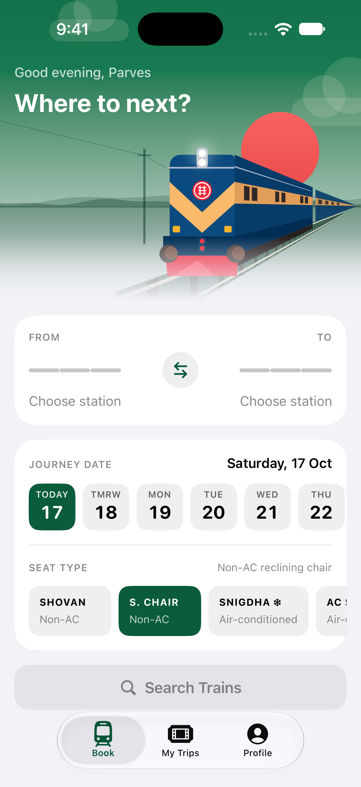
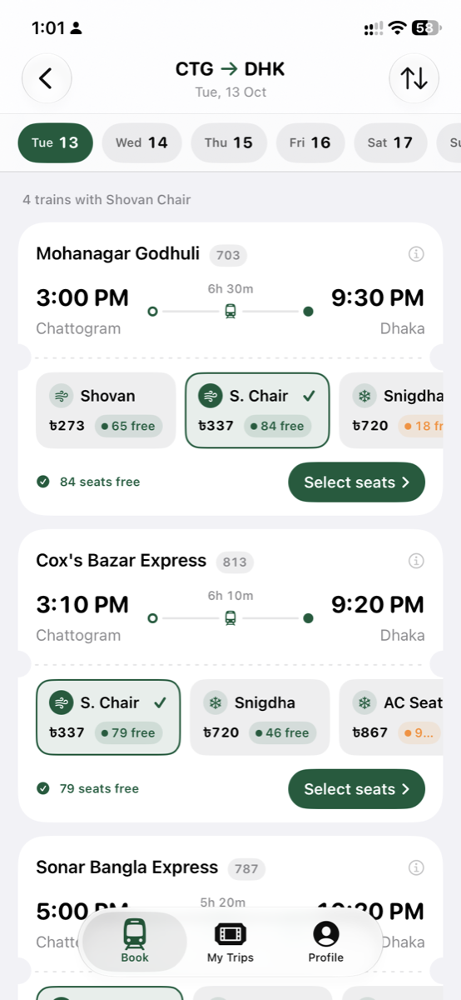
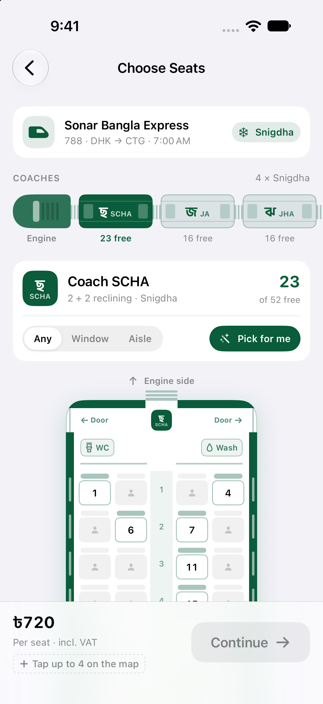
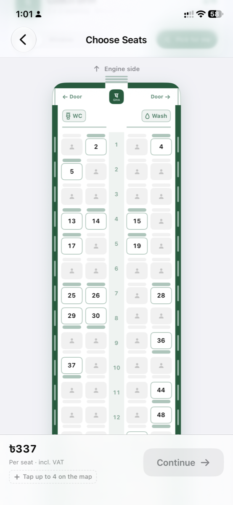
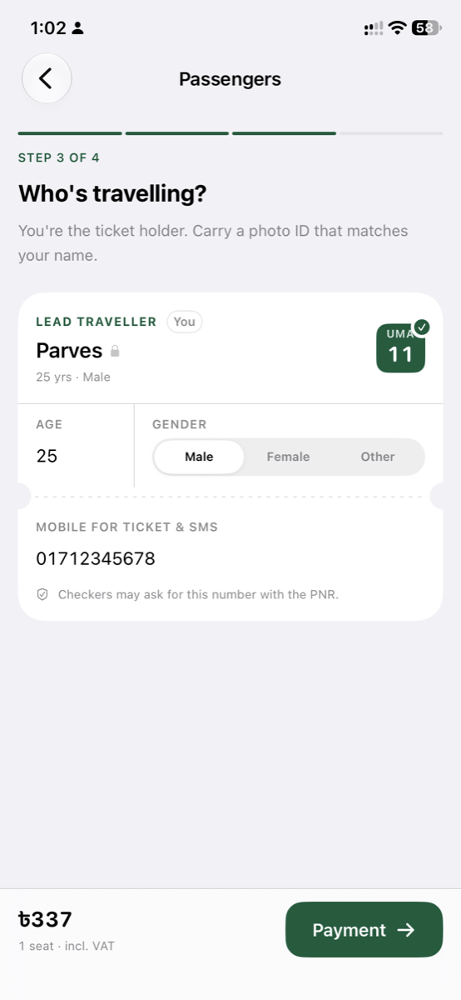
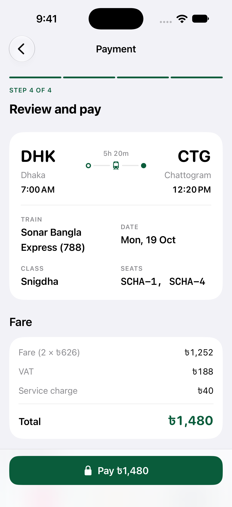
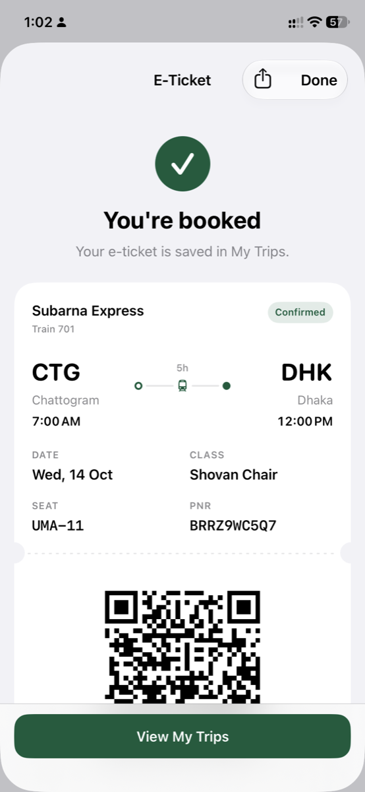
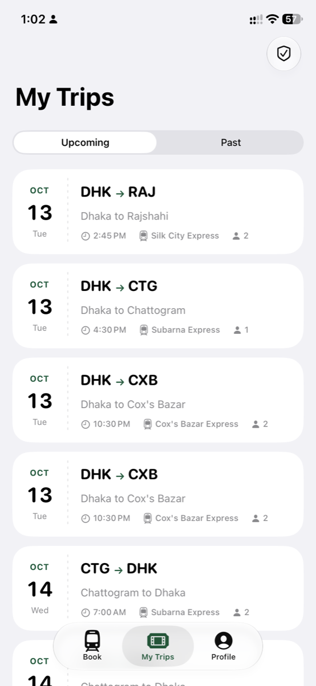
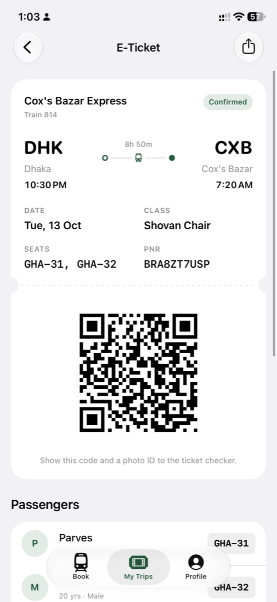

# Rail

Rail is a native iOS app for searching, booking and managing intercity train tickets. It covers the full journey from choosing a route to receiving a ticket with a scannable QR code, and it includes a verification flow for ticket checkers.

The app is written in SwiftUI and SwiftData. Data is stored on the device: accounts, bookings and saved travellers live in a local store, and the train timetable and seat map come from built-in seed data. The data layer is defined by repository protocols, so a backend can be added later without changing the screens.

## Screenshots

| Home | Results | Seat selection |
| :---: | :---: | :---: |
|  |  |  |

| Seat map | Passengers | Payment |
| :---: | :---: | :---: |
|  |  |  |

| Booking confirmed | My Trips | E-ticket |
| :---: | :---: | :---: |
|  |  |  |

## Features

- **Account:** sign up, log in and log out. Passwords are hashed, and the session is kept in the Keychain.
- **Onboarding:** a short first-run introduction.
- **Search:** pick origin and destination stations, a travel date and a seat class. Popular stations are offered as shortcuts.
- **Results and train details:** timetable, fares per seat, and availability by class for each train.
- **Seat selection:** a coach-by-coach seat map for up to four seats per booking, with window, aisle, lower and upper berth labels.
- **Passenger details:** the account holder is always the lead traveller. Other seats can be left blank or filled with a name, age and gender. Saved travellers can be added in one tap.
- **Payment:** bKash, Nagad or debit/credit card. Payments are simulated by `MockPaymentService`, which validates the wallet number or card number and returns a receipt.
- **Trips:** upcoming and past bookings, with cancellation and refund amounts for eligible bookings.
- **Tickets:** a ticket view with PNR, seats, fare breakdown and a QR code encoding the booking.
- **Verify ticket:** a checker can look up a booking by PNR and the registered mobile number.
- **Profile:** edit name and mobile number, manage saved travellers, and delete the account and its local data.

## Requirements

| Item | Version |
| --- | --- |
| Xcode | A version that ships the iOS 17 SDK or later |
| Deployment target | iOS 17.0 |
| Swift | 5.0 language mode |
| Dependency | [Inject](https://github.com/krzysztofzablocki/Inject) 1.6.0, resolved with Swift Package Manager |
| Device | iPhone (portrait), simulator or physical device |

No external services or API keys are needed to build or run the app.

## Getting started

1. **Clone the repository**

   ```bash
   git clone https://github.com/heyparves/railway-ticket-ios.git
   cd railway-ticket-ios
   ```

2. **Open the project**

   ```bash
   open Rail.xcodeproj
   ```

   Xcode resolves the Swift package on first open. If it does not, choose **File → Packages → Resolve Package Versions**.

3. **Set signing**

   In the **Rail** target, under **Signing & Capabilities**, select your own development team and make the bundle identifier unique to you (for example `com.yourname.rail`). The project file contains the original team and bundle identifier, so change them before running on a physical device.

4. **Select a destination and run**

   Choose an iPhone simulator or a connected device and press **Run** (⌘R).

## Running the tests

The `RailTests` target uses Swift Testing and covers the domain rules and the local repositories (search, booking, seat conflicts and saved passengers).

```bash
xcodebuild test \
  -project Rail.xcodeproj \
  -scheme Rail \
  -destination 'platform=iOS Simulator,name=iPhone 16'
```

Or press **⌘U** in Xcode.

## Demo mode

Debug builds accept launch arguments that skip onboarding, sign in with a demo account and open a chosen screen. This is useful for development and UI review.

| Argument | Effect |
| --- | --- |
| `-demo` | Skips onboarding and signs in as `demo@rail.app` (password `railpass1`). The account is created on first use. |
| `-demoScreen <name>` | Opens a screen with sample data. `<name>` is one of `results`, `detail`, `seats`, `passengers`, `payment`, `ticket`, `trips` or `profile`. |
| `-demoTo <code>` | Destination station code, default `CTG`. |
| `-demoClass <class>` | Seat class for results and seat selection. |

Set these in **Product → Scheme → Edit Scheme → Run → Arguments**, or pass them to the script below.

## Live reload (optional)

`scripts/hot-reload.sh` builds and launches the app with [InjectionNext](https://github.com/johnno1962/InjectionNext) and the Inject package. Saving a Swift file under `Rail/` then updates the running app in a few seconds.

Prerequisites: InjectionNext installed in `/Applications`.

```bash
scripts/hot-reload.sh sim                                  # iOS Simulator
scripts/hot-reload.sh sim -demo -demoScreen seats          # with demo arguments
scripts/hot-reload.sh                                      # physical iPhone
```

Before using the physical-device mode, replace `DEVICE_ID` and `SIM_ID` at the top of the script with the identifiers from `xcrun xctrace list devices` and `xcrun simctl list devices`. The Debug build already sets the `-interposable` linker flag the Inject package needs.

## Project structure

```
Rail/
├── App/            Entry point, root navigation, session store, app settings, demo seeder
├── Core/
│   ├── Design/     Theme tokens, shared components, ticket shapes, journey views
│   ├── Security/   Keychain store and password hashing
│   └── Utilities/  Formatting, validation, QR code, hot reload hook
├── Domain/
│   └── Models/     Stations, trains, seats, fares, bookings, users, passengers
├── Data/
│   ├── Persistence/  SwiftData entities and container
│   ├── Repositories/ Repository protocols and local implementations
│   └── Seed/         Stations, trains and timetable seed data
└── Features/
    ├── Auth/           Log in, sign up
    ├── Onboarding/     First-run introduction
    ├── Search/         Station picker, search form
    ├── Results/        Train results
    ├── TrainDetail/    Timetable and fares
    ├── Booking/        Seat selection, passengers, payment
    ├── Trips/          Bookings, ticket, ticket verification
    └── Profile/        Profile, settings, saved passengers
RailTests/          Swift Testing suites for domain and repositories
scripts/            Hot reload and icon rendering helpers
```

### Architecture

- **Screens** are SwiftUI views paired with `@Observable` view models. They talk only to repository protocols.
- **`AppContainer`** is the composition root. It wires the local implementations: `LocalAuthRepository`, `LocalTrainRepository`, `LocalBookingRepository`, `LocalPassengerRepository` and `MockPaymentService`. Replace these in `AppContainer.local(...)` to connect a real backend.
- **Persistence** uses SwiftData for profiles, bookings and saved travellers. Password hashes and the active session are kept in the Keychain through `KeychainStore`; hashing is done by `PasswordHasher`.
- **Design system:** colours, spacing and radii come from `Core/Design/Theme.swift`. Use these tokens rather than literal values.

## Data and limitations

- All data is local to the device. Uninstalling the app removes accounts, bookings and saved travellers.
- Train timetables, stations and seat maps are generated from seed data in `Data/Seed/SeedData.swift`.
- Payments are simulated. No money is charged and no payment gateway is contacted.
- Ticket verification checks against local bookings only, so it works only on the device where the booking was made.

## Contributing

1. Create a branch from `main`.
2. Keep changes within the existing folder structure and design tokens.
3. Make sure the `RailTests` target passes and the app builds without warnings.
4. Open a pull request describing the change and how it was tested.

## Licence

All rights reserved. Add a licence file before distributing the project.
